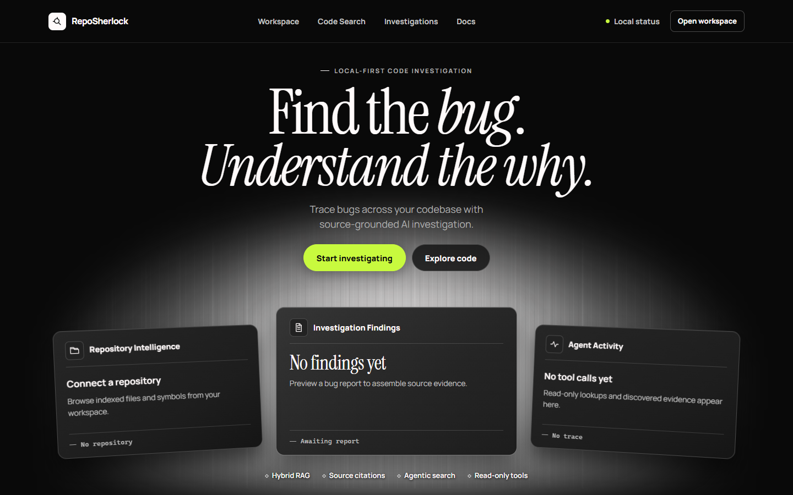

# RepoSherlock

RepoSherlock is a local-first workspace for investigating bugs in a source checkout. Give it a symptom or stack trace, search for the relevant code, and review a diagnosis with file and line references. The browser shows exactly which initial excerpts a Gemini investigation would share before you approve it.

## What it does

- Indexes local checkouts with Tree-sitter for Python, JavaScript, and TypeScript and line-window fallbacks for other supported files. Incremental updates reuse embeddings for unchanged inputs.
- Offers BM25 for identifiers and paths, MiniLM vectors for natural-language queries, and reciprocal rank fusion (RRF) to combine their ranks without calibrating their scores.
- Runs a single-pass investigation on the initial evidence or lets an agent request additional evidence through budgeted, read-only search, symbol, and line-range tools.
- Returns structured hypotheses, suggested fixes, regression ideas, validated citations, and an agent trace. It can return insufficient evidence when the snapshot cannot support a diagnosis.

[Repository indexing](docs/screenshots/indexing.png) · [Hybrid search](docs/screenshots/search.png) · [Investigation workspace](docs/screenshots/workspace.png) · [Evidence preview](docs/screenshots/evidence-preview.png) · [Result and citations](docs/screenshots/result-citations.png) · [Agent trace](docs/screenshots/agent-trace.png)

The workflow screenshots use the bundled synthetic receipt repository and a scripted Gemini response intercepted locally.

## Architecture

The Next.js and React browser UI talks to a same-origin Node bridge. The bridge attaches the FastAPI bearer on the server. FastAPI scans allowed source directories, indexes Tree-sitter chunks with CPU MiniLM embeddings and ChromaDB, and merges semantic and BM25 rankings. The investigation service prepares a preview, validates approval against the current snapshot, and checks returned citations against the exact evidence supplied to the model.

| Layer | Stack |
| --- | --- |
| Workspace and local bridge | Next.js, React, TypeScript |
| API, jobs, and validation | FastAPI, Uvicorn, Pydantic |
| Index and retrieval | Tree-sitter, Sentence Transformers, CPU PyTorch, ChromaDB, BM25, RRF |
| Investigation | Google Gen AI SDK, structured reports, bounded source tools |

[Architecture diagram](docs/ARCHITECTURE.md#request-and-disclosure-flow) · [HTTP API](docs/HTTP_API.md) · [Frontend](docs/FRONTEND.md) · [CLI](docs/CLI.md)

## Windows setup

Use Windows PowerShell, Python 3.12 (3.11 is the package minimum), and Node.js 24 with npm. The pinned MiniLM weights take about 87 MiB, in addition to packages and local indexes. The initial install and model download need internet access. A CPU is sufficient.

Run from the project root in Windows PowerShell.

~~~powershell
py -3.12 -m venv .\backend\.venv
$python = '.\backend\.venv\Scripts\python.exe'
& $python -m pip install --upgrade 'pip>=26.3,<27'
& $python -m pip install torch --index-url https://download.pytorch.org/whl/cpu
& $python -m pip install -e './backend[semantic,embeddings,investigation,test]'
npm.cmd --prefix .\frontend ci
~~~

If Python 3.12 is on your PATH outside the Windows Python launcher, use its executable with `-m venv .\backend\.venv`. Each command should succeed before continuing.

### Launch and pair

~~~powershell
$env:REPOSHERLOCK_ALLOWED_ROOTS = (Resolve-Path '.\backend\tests\fixtures').Path
.\scripts\start-dev.ps1
~~~

Open [RepoSherlock](http://127.0.0.1:3000/) after both services report ready. In the launcher console press **T**, paste the code into **Local pairing code**, and select **Connect session**. The clipboard entry is temporary and excluded from Windows history and cloud sync. Press **Ctrl+C** in the launcher console to stop both services. FastAPI is available at [local health](http://127.0.0.1:8000/api/health) and [API docs](http://127.0.0.1:8000/docs).

Register the absolute path of a repository inside an allowed root. For a different checkout, set the allowed root before launch. To list multiple roots on Windows, separate absolute paths with semicolons. Build the index, choose **Hybrid** under Code search, and search for a function or describe the behavior. For the bundled fixture, enter `receipt_total`. The first semantic index downloads the pinned weights into the selected Hugging Face cache. Set `HF_HOME` before launch to choose a cache directory.

Paste a bug report under Investigation, select a strategy, and open **Preview source disclosure**. Review the issue, excerpt list, and scope. Approve only if you can share that data. Open the citations and agent activity after the result. [Repeatable receipt demo and offline option](docs/DEMO_GUIDE.md)

### Configure live Gemini access

A key is optional for local indexing, search, and previews. For an authorized live investigation, start in a fresh PowerShell session and enter the key through a secure prompt.

~~~powershell
$env:REPOSHERLOCK_ALLOWED_ROOTS = (Resolve-Path '.\backend\tests\fixtures').Path
$env:GEMINI_API_KEY = [System.Net.NetworkCredential]::new('', (Read-Host 'Gemini API key' -AsSecureString)).Password
try {
    .\scripts\start-dev.ps1
} finally {
    Remove-Item Env:GEMINI_API_KEY -ErrorAction SilentlyContinue
}
~~~

Set `GEMINI_MODEL` in the launching shell if you need an account-enabled model override. The launcher passes the Gemini key to FastAPI only. [.env.example](.env.example) lists configuration names for reference.

## Safety and limitations

This is a single-user, loopback-only workspace. The browser receives a signed HTTP-only session cookie after pairing. Repository paths must stay within configured roots. Approval expires, is single-use, and binds the redacted issue, selected strategy, model, and initial evidence to a verified source snapshot. Agentic approval also covers bounded additional redacted excerpts from that snapshot. Redaction is heuristic. Local JSONL and Chroma indexes may contain source, so protect them like the checkout.

Citations establish source identity and quote fidelity. A human still judges whether a hypothesis follows from the cited code and whether a suggested fix works. The agent reads evidence without executing repository commands or applying changes. Jobs and approval state are process-local. Startup costs and repeated freshness checks should be measured against your own repository. Larger labelled datasets and measured retrieval scaling are future work.

## Testing and benchmarks

Run these from the project root after setup.

~~~powershell
$python = '.\backend\.venv\Scripts\python.exe'
& $python -m pytest -q backend/tests
& $python -m compileall -q backend/reposherlock scripts
& $python -m pip check
npm.cmd --prefix .\frontend run typecheck
npm.cmd --prefix .\frontend run lint
npm.cmd --prefix .\frontend test
npm.cmd --prefix .\frontend run build
~~~

- **Retrieval** measures labelled source coverage and ranking for semantic, BM25, and hybrid on 22 positive and five unsupported project-source queries. [Dataset](benchmarks/reposherlock.json) · [Method](docs/ARCHITECTURE.md#retrieval-evaluation)
- **Investigations** pair both strategies on nine synthetic cases using a scripted provider. A separate historical one-case Gemini CLI run illustrates the additional evidence, time, and requests that agentic retrieval can consume. [Benchmark and measured results](docs/INVESTIGATION_BENCHMARK.md)
- **Browser integration** runs real local services and intercepts the Gemini SDK transport. It verifies pairing, indexing, search, preview, approval, citations, trace, and job recovery without a provider key. [End-to-end testing](docs/END_TO_END_TESTING.md)

[Release checklist](docs/RELEASE_CHECKLIST.md) · [Final audit](docs/FINAL_AUDIT.md) · [Interview preparation](docs/INTERVIEW_PREPARATION.md) · [Build log](docs/BUILD_LOG.md)