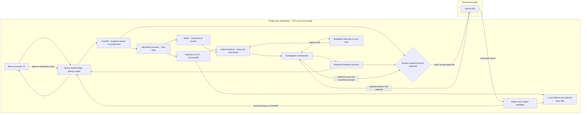

# RepoSherlock architecture

## Request and disclosure flow

Indexing, search, preview, and report validation run on the workstation. A first-time embedding model download is separate from the Gemini request path. Failed freshness or consent checks prevent disclosure. Single-pass submits the initial evidence. Agentic approval also covers bounded additional redacted evidence from the same snapshot. Citations are checked against the evidence that was actually sent, including source ranges and any returned quote.

## Phase 1

The CLI validates a local directory and builds one index. The FastAPI app independently exposes `GET /api/health` with a Pydantic response. Ingestion can also be called from Python through `index_repository(path, scan_limits, chunk_settings)`.

| Module | Responsibility |
| --- | --- |
| `core/config.py` | Validate scan budgets and chunk window settings. |
| `ingestion/scanner.py` | Traverse the directory in sorted depth-first order, prune excluded directories, and emit accepted source files or skip records. |
| `ingestion/chunker.py` | Produce overlapping line windows that preserve source line endings. |
| `ingestion/indexer.py` | Stream JSONL rows to disk, collect scan statistics, and publish the manifest. |
| `cli.py` | Parse options and report counts, output paths, or errors. |
| `main.py` | Serve the HTTP health endpoint. |

### Scanner and chunk contract

The scanner reads regular UTF-8 files and enforces limits on individual file size, accepted file count, and total accepted source bytes. A rejected candidate leaves the remaining scan budget available for later files. Traversal continues so the manifest can report skipped candidates. Pruned directories are reported once without enumerating their contents. `scanned_files` is the sum of `indexed_files` and `skipped_files`. Directory links are skipped entries counted with files because the scanner does not follow the link to classify its target. `skipped_directories` counts directories the scanner recognized and did not enter.

Chunk rows have `chunk_id`, `relative_path`, `language`, `start_line`, `end_line`, and `content`. Paths are repository-relative and use forward slashes. Line numbers are one-based and inclusive. Chunk IDs are SHA-256 hashes of the JSON-encoded path, range, and original chunk text. The same input and settings produce the same chunk rows. Use a source tree that stays stable during ingestion to get a coherent snapshot.

### Index publication

The repository ID hashes the canonical absolute path with platform path casing rules. It stays stable for the same local checkout path. Moving or copying the checkout gives it a new ID. The manifest stores the ID and repository-relative metadata.

The writer stages and flushes both files under the index directory. It publishes a content-addressed JSONL file first, then atomically replaces the manifest, which is the entry point for readers. The manifest contains the JSONL filename, its digest, schema version, settings, statistics, and skip details. A reader that has opened a manifest can read its referenced JSONL even if a newer manifest is published. If publication stops before the manifest swap, the previous index stays readable and an unreferenced JSONL may remain. Old JSONL files are retained until manually removed while indexing and reading are idle. Importers should use the manifest pointer for the active snapshot.

## Phase 2

The semantic CLI reuses the scanner and snapshot writer. Phase 1's schema-1 manifest and line-based chunk IDs continue to work. The semantic writer publishes a separate schema-2 `semantic-manifest.json` that also records the accepted source fingerprint and chunker version. Both manifests use the same content-addressed JSONL mechanism.

| Module | Responsibility |
| --- | --- |
| `ingestion/syntax_chunker.py` | Partition parsed source by named symbols, preserving text outside those symbols. |
| `semantic/embeddings.py` | Load the pinned MiniLM checkpoint lazily and encode normalized vectors on CPU. |
| `semantic/storage.py` | Verify source and vector state, lock repository operations, and open the local Chroma database. |
| `semantic/indexing.py` | Reuse vectors in batches and publish the active collection. |
| `semantic/retrieval.py` | Return structured source hits for a repository ID, query, and top-K count. |

### Source and embedding contract

Tree-sitter locates function, class, method, and selected declaration boundaries. A nested symbol owns its text, and its enclosing symbol contributes the spans before and after it. Module imports, comments, and executable code remain available. Isolated whitespace-only spans are omitted. Unsupported languages and parse errors use the Phase 1 window algorithm, with a shorter semantic default. Large spans are split at line or UTF-8 character boundaries to a limit of 900 bytes.

Semantic rows add `repository_id`, `symbol_name`, `symbol_type`, `strategy`, and UTF-8 byte columns. Line numbers remain one-based and inclusive. Columns are zero-based, with an exclusive end column relative to the last line. Chunks can begin or end partway through a line. IDs include path, coordinates, symbol metadata, strategy, and exact text. Line shifts can change a chunk ID while leaving its embedding input identical.

The pinned `sentence-transformers/all-MiniLM-L6-v2` model uses the same encoder for code and queries. Code input adds a path and an optional qualified symbol name to the exact text. Each label is capped at 140 characters. MiniLM truncates inputs beyond 256 wordpieces, including special tokens. Original source text in the index remains intact. Chroma uses cosine distance. The application reports `1 - distance` as cosine similarity, with higher values indicating closer matches. Similarity estimates relevance and cannot establish a bug. [MiniLM model card](https://huggingface.co/sentence-transformers/all-MiniLM-L6-v2)

### Publication, incremental updates, and retrieval

Each checkout has a separate Chroma database under its index directory. RepoSherlock serializes Chroma operations for that checkout. A build writes the semantic JSONL, then prepares an isolated Chroma collection in small batches. It compares embedding-input hashes against compatible previous records and copies matching vectors even if line numbers changed. An unchanged snapshot avoids model loading and collection replacement. Updated counts pair changed IDs at a matching file, start line, and start column. Shifted coordinates can therefore count as added and removed while the underlying embedding is reused.

The writer validates the staged record count and atomically replaces `vectors.json` to activate the collection. Previous and abandoned collections are removed after a successful commit or on a later build. A failed update can leave the source manifest ahead of the active vectors. Retrieval compares both digests, the model identity, dimensions, count, and collection metadata, and rejects this state. A retry can reuse vectors from the previous committed collection. `--rebuild` starts a fresh collection while keeping the previous pointer until publication succeeds.

Every search verifies the accepted source fingerprint and JSONL digest before querying. Search therefore includes a bounded read of the source tree and active JSONL. Use a stable checkout during indexing and search. Older JSONL snapshots remain available for direct readers.

## Phase 3

`RetrievalService.search(repository_id, query, top_k, mode=...)` returns source chunks with scores, contributing ranks, final rank, and evidence diagnostics. `SemanticSearch` remains available with its Phase 2 result format.

- `retrieval/tokenizer.py` normalizes Unicode and case, retaining complete paths and identifiers alongside words split on camel case, separators, and digit boundaries. Query stop words are ignored. Original source stays intact.
- `retrieval/lexical.py` implements positive-IDF Okapi BM25 with `k1=1.2` and `b=0.75`. Source occurrences and distinct path aliases count once each. Distinct symbol aliases add three occurrences, helping symbol definitions outrank incidental mentions. Results with no lexical match are omitted.
- `retrieval/fusion.py` deduplicates stable chunk IDs and sums `1/(k + rank)` from the contributing lists with one-based ranks. The default `k` is 60. Chunk IDs break ties. Cosine similarity and BM25 scores remain visible on their own scales. RRF values represent rank contributions.
- `retrieval/evidence.py` checks the first five candidates or fewer. It looks for an exact symbol or file reference. Otherwise it requires two meaningful query terms in one candidate when there are at least two terms, and at least half of all meaningful terms across the leading candidates. Method agreement is also reported. The heuristic can miss paraphrases or flag coincidental overlap.

The service checks source freshness and the JSONL digest while holding the existing repository lock. BM25 builds an in-memory postings index on first use and retains one verified snapshot per service instance. Lexical mode can use a fresh source manifest even if vector publication was interrupted. Semantic and hybrid modes require compatible vectors for that same manifest. Hybrid also checks returned vector payloads against the canonical JSONL chunks. Snapshot changes invalidate the lexical cache. No additional index is written, and vector indexing retains its existing incremental behavior.

The in-memory design avoids maintaining a second persistent index for small checkouts. For larger repositories, measure postings size, build time, and repeated file hashing before choosing a disk-backed index. A future persistent cache would need to be keyed to the verified snapshot. Presentation removes duplicate chunk IDs while retaining distinct spans of a symbol, since those spans can carry different code.

### Retrieval evaluation

The [benchmark](../benchmarks/reposherlock.json) uses real RepoSherlock source. Positive queries cover prose, identifiers, file locations, paraphrases, and bug-like descriptions. Labels identify the source that implements the requested behavior by file, symbol, and optional content anchor. Anchors distinguish spans of a large function and allow line numbers to move. Negative queries cover features absent from the checkout. They are evaluated separately from ranked recall.

`python -m reposherlock.evaluation` validates labels and runs each mode over the same queries. Recall@1 and Recall@5 average the fraction of labelled targets found per positive query. MRR@5 averages the reciprocal rank of the first matched target, with zero for a miss. Negative and positive flag counts use the same evidence diagnostic. Median latency uses all timed queries after one warmup per mode. First-query timings include model loading for semantic and postings construction for lexical. The first hybrid query reuses both.

## Phase 4

The `investigate` CLI uses the Phase 3 hybrid service. It carries the retrieved source and chunk digests into the investigation and checks them against the current verified snapshot before submission and after receiving the provider reply. The repository lock is held during each check and released during provider I/O.

| Module | Responsibility |
| --- | --- |
| `investigation/context.py` | Select ranked excerpts within JSON, excerpt count, and source byte limits, suppress overlap, and assign evidence IDs. |
| `investigation/redaction.py` | Mask recognizable credentials and sensitive assignments while preserving line breaks. |
| `investigation/provider.py` | Enforce direct opt-in at the provider boundary, issue structured Gemini requests, and sanitize transport errors. |
| `investigation/report.py` | Parse strict Pydantic output, enforce status consistency, and validate citations and optional quotes. |
| `investigation/service.py` | Coordinate consent, hybrid retrieval, freshness checks, and a single provider generation. |

### Evidence and privacy

`--dry-run` uses the same selection and redaction as a live investigation, with no provider initialization. `--allow-remote-code` is required for live calls. The remote user content is a single JSON object containing the redacted bug report and selected source excerpts with their relative paths, line ranges, and symbols. API keys are read from the process environment and passed through the SDK authentication header. The adapter targets the Gemini Developer API, disables redirects and SDK recording, and retries only selected transient HTTP, connection, and timeout errors. Raw provider errors and bodies stay out of CLI output.

Selection reuses stable chunk IDs locally and gives excerpts `S1`, `S2`, and subsequent IDs in rank order. It omits repeated IDs and excerpts mostly covered by one already selected. It sends at most 75 percent of the indexed source bytes before redaction and can clip the first candidate at a line boundary to stay within that limit. The manifest byte count is checked against the accepted source scan. A very small checkout can leave no complete excerpt within budget.

The system instruction treats issue text and snippets as untrusted data and supplies no tools. Citation metadata must match an excerpt exactly. Citation paths, symbol fields, and inclusive lines are built from the local registry, and optional quotes must occur verbatim in its redacted text. Retrieval warnings are carried forward without blocking investigation. The model can abstain, and an empty usable context produces an abstention without a provider call. Schema and citation checks cannot establish the truth of a model's explanation. The report records verification as unperformed.

## Phase 5A

`investigation/agent.py` runs a bounded evidence-gathering session for a single repository. The Phase 4 command remains the default. The agent starts with the same hybrid retriever and the same redaction and source byte budget. An append-only registry preserves initial evidence IDs and assigns new IDs to usable tool excerpts. Repeated tool arguments reuse prior evidence IDs without running the tool again. Overlapping excerpts are deduplicated where possible.

`investigation/tools.py` exposes exactly `search_code`, `read_code_lines`, and `find_symbol`. Pydantic rejects extra fields and coerced values. A line-read path is matched as text against the scanner's accepted entries and never opened directly. The bytes held from that scan are included in the verified snapshot digest. Exact path matching and explicit rejection of Windows drive, UNC, device, and traversal spellings protect the lookup boundary. Symbol lookup returns indexed spans and exposes ambiguity. Tools cannot execute code or access the network.

`investigation/agent_provider.py` sends manually declared function tools with automatic SDK calling disabled. The application validates and dispatches each accepted request locally. Continuations replay SDK assistant content and prior tool responses, matching each function response to its original call ID. Each tool response adds only new redacted excerpts and references to known evidence. The separate final call receives the evidence registry, a JSON schema, and no tool declarations. [Google Gen AI SDK](https://googleapis.github.io/python-genai/) · [Manual function calling](https://ai.google.dev/gemini-api/docs/function-calling)

Each invocation has limits for planning rounds, model requests, tool calls, line reads, and cumulative evidence size. One model request is reserved for the final report. The approximate planning conversation budget also accounts for assistant metadata and earlier tool responses. Calls are serial. Snapshot checks run before each continuation and before and after final generation. A stale snapshot fails closed. A planner transport failure or invalid final citation produces an explicit insufficient-evidence result. The trace records metadata only, with logical source character counts that include replay and exclude transport retries.

The SDK uses automatic function selection with manual execution. The planner may return a standalone `finish_investigation` control call without arguments or complete with a no-tool text response. A finish call bypasses the repository tool registry. Tool feedback separates familiar IDs from newly registered IDs. Exact duplicate requests reuse cached metadata. New excerpts reset the idle-round counter, and two consecutive rounds without new excerpts stop planning when another round would otherwise be available. The configured round and request limits remain fallbacks. A valid read that crosses EOF is clamped to its actual ending line within the same requested line and character budgets. The trace records the returned range and truncation flag even when overlap prevents the excerpt from adding evidence.

`usage_summary` aggregates per-request usage for the CLI and JSON trace. Each token count includes its reporting coverage. An invalid response can still contribute its SDK-reported usage. Missing fields, failed attempts with no SDK metadata, and transport retries with no reported usage cannot be reconstructed. The lexical-overlap diagnostic remains available and does not gate investigation.

The cross-file test fixture models a fee charged at exactly 5,000 cents. `checkout.py` delegates to `standard_fee` in `rates.py`. The helper compares `subtotal_cents > FREE_SHIPPING_AT_CENTS` and therefore omits equality. This root cause was established by inspection of the fixture. The fixture and proposed regression test are never executed by RepoSherlock.

## Phase 5B

`benchmarking/dataset.py` validates a versioned suite of synthetic bug reports and human ground truth. The runner copies scanner-accepted source into one local staging checkout per selected fixture and indexes it with the pinned cached MiniLM model. It verifies each expected symbol and inclusive range against the chunk index. Both strategies receive the same issue, snapshot digests, hybrid configuration, initial source limit, overall context limit, model ID, report schema, and citation rules. Run order alternates by case to reduce first-in-pair overhead. Agentic planning, tool lookups, and context growth remain part of the evaluation.

`benchmarking/runner.py` calls the existing investigation functions and captures ranked source references independently of the redacted context registry. It checks an expected source and chunk digest before the provider receives evidence. The existing snapshot rechecks continue to guard tool reads and final output. Ground truth stays with the scorer and reviewer. A scripted provider uses canned symptom and excerpt rules for offline integration checks. The optional live path uses the existing Gemini adapters and reserves each physical generation attempt in an atomic checkpoint before dispatch, including transport retries.

`benchmarking/metrics.py` scores references, evidence changes, and abstention eligibility. It keeps citation validation, source localization, and diagnosis judgments distinct. `benchmarking/reporting.py` emits a paired summary and a human review worksheet. The result checkpoint retains snapshot hashes, redacted report text, metadata-only traces, unfinished attempt history, and the lifetime request ledger. Resume checks configuration and fixture digests before reusing completed rows or continuing. A human review binds to the exact result rows and yields a separate summary.

## Phase 6A

`main.create_app` composes the local FastAPI lifespan and domain routers. The lifespan owns the repository registry, one cached CPU embedding backend, the preview store, and the bounded in-process worker. Request models are strict and errors use a fixed problem envelope. The HTTP layer reuses the scanner, semantic indexer, retrieval service, investigation strategies, citation validator, and metadata trace.

Repository registration checks the configured root before querying the candidate. Every path component must be a real directory, including ancestors. The registry retains the canonical ID and directory identity. Operations recheck scope and identity, and the public path label is relative to an allowlist entry. Searches verify indexed source, redact returned snippets, and label clipped excerpts. Semantic-only retrieval also compares returned vector records with the verified JSONL.

The worker runs one job at a time with at most four outstanding jobs and 64 retained job records. Duplicate index work for a repository is rejected while its previous job is active. The semantic pipeline reports actual scan, staged vector batch, and publish milestones. At shutdown, queued work is cancelled and active work can finish within its existing service limits. A shared workspace lock serializes source work. Job polling runs independently.

Preview uses the investigation dry-run path and records an expiring, single-use approval ID bound to the repository identity, source and chunk hashes, effective configuration, strategy, model, redacted issue, and exact initial context digest. The worker repeats snapshot checks and verifies the regenerated initial context before the first provider request. The Gemini transport also rechecks source and index digests before each physical attempt. Agentic approval covers bounded additional disclosure from that snapshot. The API turns provider and citation failures into failed jobs, while valid insufficient-evidence reports stay completed.

A manual local bearer token protects repository, job, and investigation endpoints. The request boundary enforces loopback hosts, explicitly allowed browser origins, and bounded UTF-8 JSON bodies. CORS is configured independently of authorization. OpenAPI is available locally and optional Swagger UI assets are served from a trusted local directory.

## Phase 7A

The browser uses the Next.js Node route at `/api/local`. The launcher generates separate credentials for browser pairing and the FastAPI bearer. Pairing issues a signed HTTP-only, SameSite Strict cookie that expires after eight hours or becomes invalid when the launcher rotates the bearer. The bridge checks the loopback host, requires a same-origin header for state-changing requests, bounds request and response sizes, and checks the method and path against its fixed route allowlist. It attaches the FastAPI bearer server-side and disables redirects. Upstream errors remain errors. The browser bundle and responses omit the bearer and Gemini key.

Workspace polling is cancellable on navigation. A missing process-local job or repository releases the UI's tracking lock so the operator can register again. A stale approval clears consent and requires a fresh snapshot. Result citations can open an exact matching excerpt from the initial disclosure or a validated quote from the report. The trace remains metadata-only. The production-build browser smoke connects real local services and replaces the Gemini SDK HTTP transport with a deterministic fixture. [Test and measurement guide](END_TO_END_TESTING.md)

### Planned components

These components are planned for future phases.

- GitHub checkout ingestion and repository management
- Retrieval ranking improvements informed by broader benchmarks
- Broader live investigation evaluation and patch suggestions

Future phases can build on the structured, source-cited investigation report.
